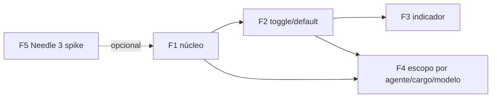

# Code Mode: levantamento de requisitos

> Complementa [code-mode-plan.md](code-mode-plan.md). Este documento separa as funcionalidades e lista requisitos, decisões em aberto e pontos de integração. O plano descreve o núcleo (partição bridge-only); aqui ficam controle, escopo e indicador. Base: `kaioposnky/omp` em `3231d5e26c`.

Convenções: **RF** = requisito funcional, **RNF** = não funcional, **D** = decisão em aberto (opção recomendada marcada com ★).

## Visão geral

| # | Funcionalidade | Depende de |
| --- | --- | --- |
| F1 | Núcleo Code Mode (partição bridge-only) | — (descrito em `code-mode-plan.md` §4) |
| F2 | Ativar/desativar e default | F1 |
| F3 | Indicador na tela | F2 |
| F4 | Escopo por agente/cargo/modelo (mini config) | F1, F2 |
| F5 | Needle 3 para JSON/tool calling (avaliação) | independente |



---

## F2: ativar, desativar e default

### Requisitos

- **RF2.1** Setting persistente `codeMode.default` (`boolean`), que define o estado inicial de toda sessão nova. Default de fábrica: `true`, adotado após a medição do plano §7 (`docs/code-mode/micro/token-economy-model-behaviors.md`).
- **RF2.2** Slash command `/code-mode [on|off|status|default on|default off]`.
  - `on`/`off` não alteram a sessão atual (D2.1). Eles abrem uma sessão nova já no estado pedido, como `/new` com override. Se a sessão atual estiver vazia (sem mensagens), aplicam nela mesma.
  - `default on|off` grava `codeMode.default` (persistente) sem mexer na sessão atual.
  - `status` mostra o estado efetivo, a origem dele (flag, sessão, default, regra de escopo) e quantas tools estão em bridge-only.
  - Padrão a seguir: `/fast` em `slash-commands/builtin-modes.ts:551` (`handle` + `handleTui` + `getTuiAutocompleteDescription` + `refreshStatusLine`).
- **RF2.3** Flags de CLI `--code-mode` e `--no-code-mode` sobrepõem o default só para aquele processo (`cli/flag-tables.ts`).
- **RF2.4** Entrada em `/settings`, aba Tools, grupo "Discovery & MCP", ao lado de `tools.xdev` (`tools/settings.ts:961`).
- **RF2.5** Persistência por sessão: o estado é gravado no session file. `--resume`/`/resume` restauram o estado que a sessão tinha, e não o default atual.
- **RF2.6** Atalho de teclado opcional e sem binding padrão, configurável via `docs/keybindings.md`.
- **RF2.7** Pré-condição: sem backend `eval` disponível, `on` é recusado com mensagem clara e o estado continua `off`.
- **RF2.8** RPC/ACP: expor `codeModeEnabled` no estado da sessão, igual a `fastModeEnabled` em `modes/rpc/rpc-mode.ts:2090`, e aceitar um comando para alternar.

### Requisitos não funcionais

- **RNF2.1 Estado congelado por sessão.** O conjunto de tools e o system prompt são definidos na criação da sessão e não mudam depois (D2.1). Isso elimina a perda de cache no meio da sessão e o risco de o provider rejeitar tool calls antigas cujas tools saíram do schema.
- **RNF2.2 Fork e resume.** `/fork` e `/resume` herdam o estado gravado na sessão de origem, porque reaproveitam o histórico dela.

### Decisões (fechadas)

- **D2.1** Toggle só em sessão nova (`/new` ou `/code-mode on|off`, que cria uma sessão). ✔
- **D2.2** O default vale só para sessões novas. Resumidas mantêm o estado gravado. ✔

---

## F3: indicador na tela

### Requisitos

- **RF3.1** Ícone no segmento de modelo do status line, no mesmo lugar do ⚡ do fast mode (`tui/src/status-line/segments.ts:368`). Exemplo: `claude-opus ⟨/⟩ · high`.
- **RF3.2** Novo símbolo `icon.codeMode` no tema (`tui/src/theme/symbols.ts`), com versões Unicode e Nerd Font (ex.: `⟨/⟩` / `\uf121`), igual a `icon.fast` (linhas 499/898).
- **RF3.3** O host expõe `isCodeModeActive()` em `tui/src/status-line/host.ts`, que é lido em `component.ts:2798` e entra na comparação de igualdade em `component.ts:2863`. Sem isso o status line não re-renderiza.
- **RF3.4** Se a regra de escopo diverge do estado congelado (ex.: `/model` trocou para um modelo `off`), o ícone fica `muted` e `/code-mode status` explica que vale a partir da próxima sessão. Ativo usa `accent`.
- **RF3.5** Cards de subagente (task/eval `agent()`) mostram o mesmo ícone quando o filho roda em Code Mode. Sem isso o usuário não vê o resultado de F4.
- **RF3.6** Segmento configurável: o usuário pode escondê-lo via `statusLine.segmentOptions`, como os demais.
- **RF3.7** Startup snapshot: incluir o campo em `tui/src/status-line/startup.ts` (há validação de tipo em `:163`) para o indicador aparecer já no primeiro frame.

### Decisões

- **D3.1** Ícone junto ao modelo, igual ao ⚡ do fast. ✔

---

## F4: escopo por agente, cargo (model role) e modelo

### Contexto do código

- **Agentes** (`task`, `scout`, `sonic`, `designer`, `reviewer`…) vêm do frontmatter em `~/.omp/agent/agents/*.md` e dos bundled. O tipo fica em `AgentDefinition` (`task/types.ts:271`).
- **Cargos** são as model roles em `config/model-roles.ts:38-69`: `default`, `smol`, `slow`, `plan`, `task`, `advisor`, `tiny`…
- Já existem overrides por agente em `task/settings.ts`: `task.agentModelOverrides`, `task.agentServiceTierOverrides`, `task.agentCompactionThresholdOverrides`. A mini config segue esse padrão (record + `validate`).

### Requisitos

- **RF4.1** A mini config `codeMode.scope` decide o estado por três chaves. Cada valor é `true`/`false`, e uma chave ausente herda.
  ```yaml
  codeMode:
    default: false          # F2
    scope:
      main: true            # sessão principal
      agents:               # nome do agente (frontmatter `name`)
        task: true
        scout: false
        sonic: false
        reviewer: false
      roles:                # model role resolvida
        smol: false
        tiny: false
        slow: true
      models:               # glob sobre provider/id
        "*haiku*": false
        "9router/cc/*": true
  ```
- **RF4.2** Frontmatter opcional `codeMode: true|false` em agentes, adicionado a `AgentDefinition` e ao parser de agentes. O usuário pode fixar o comportamento no próprio agente.
- **RF4.3** Precedência, da mais forte para a mais fraca:
  1. flag CLI ou toggle de sessão (só na sessão principal)
  2. parâmetro explícito no spawn (`task` item `codeMode` ou `agent(..., codeMode=…)`), escolhido pelo modelo (D4.3)
  3. frontmatter `codeMode` do agente
  4. `scope.agents[nome]`
  5. `scope.models[glob]` (primeiro match na ordem do arquivo)
  6. `scope.roles[role]`
  7. `scope.main` (sessão principal) ou `codeMode.default`
- **RF4.4** A resolução acontece no spawn do filho, depois que o modelo é resolvido (a role e o glob dependem dele), em `task/structured-subagent.ts`, e o resultado é repassado ao `createAgentSession` do filho.
- **RF4.5** O filho não herda o estado do pai: ele é recalculado pelas regras. Exemplo: o main em Code Mode spawna `scout` e o `scout` roda normal.
- **RF4.6** Troca de modelo no meio da sessão (`/model`, prewalk hand-off, fallback de rate limit) **não** muda o estado (RNF2.1). A regra é só reavaliada para o indicador (RF3.4) e para `status`.
- **RF4.6b** Parâmetro de spawn `codeMode?: boolean` no item do `task` e em `agent()`/`workpool()` (`eval/agent-bridge.ts` `agentArgsSchema`). Os gates duros de RF4.10 ainda vencem. Quando o pedido é negado, o resultado do spawn diz o motivo ao modelo (ex.: `codeMode ignored: agent has no eval`).
- **RF4.6c** Prompt das tools `task` e `eval-agents.md`: explicar quando pedir `codeMode` (muitas chamadas encadeadas, filtragem de dados grandes) e quando não (poucas edições pontuais).
- **RF4.7** `/code-mode status` mostra a regra que decidiu, ex.: `off (scope.roles.smol)`.
- **RF4.8** Validação: chave de agente desconhecida gera warning, sem erro, porque agentes podem ser instalados depois. Glob inválido gera erro no load do setting.
- **RF4.9** UI em `/settings`: seção "Code Mode" que edita todo o `codeMode.*` sem abrir o arquivo (D4.2):
  - toggle `default` e `main`
  - lista de agentes descobertos e lista de roles de `MODEL_ROLES`, cada uma com ciclo `on → off → herda`
  - lista editável de regras de modelo: adicionar glob, alternar on/off, remover, reordenar (a ordem importa em RF4.3.5)
  - preview "estado efetivo" por agente com o modelo resolvido atual
  - grava em `config.yml` pelo mesmo caminho dos outros settings; o arquivo continua editável à mão
- **RF4.10** Gates duros que nenhuma regra sobrepõe:
  - agente sem `eval` na lista `tools` do frontmatter fica `off`, porque Code Mode sem eval deixaria o agente sem ferramentas
  - plan mode (`plan-mode/`) restringe as tools a leitura, então o Code Mode só pode expor via bridge as tools que o plan mode permite
  - sessões `restrictToolNames` (`sdk.ts:801`) respeitam a lista explícita

### Decisões

- **D4.1** `main` herda o default; `smol`/`tiny`/`sonic`/`scout` off; o resto herda. ✔
- **D4.2** `config.yml`, editável integralmente pela UI do omp (RF4.9), mais o frontmatter opcional. ✔
- **D4.3** O modelo pode pedir `codeMode` no spawn, com prioridade 2 (RF4.6b). ✔

---

## F5: Needle 3 (Cactus Compute)

### O que é (fontes)

- Modelo on-device de **tool calling, extração estruturada e embeddings**. Apache-2.0. [HF model card](https://huggingface.co/Cactus-Compute/needle3)
- 25–121M parâmetros, 8–29 MB em CQ2 2-bit, de 2 a 20 camadas a partir de um único peso. Lançado em 2026-09-17. [cactuscompute.com/needle](https://cactuscompute.com/needle), [Better Stack](https://betterstack.com/community/guides/ai/needle3-edge)
- Runtime via pacote Python `cactus-compute`/`cactus-needle` ou WebAssembly. [PyPI](https://pypi.org/project/cactus-needle/)

### Relação com o Code Mode

O Code Mode **reduz** a necessidade de JSON de tool call: o modelo principal passa a escrever código, e os argumentos de cada `tool.*` são validados no bridge. A Needle não resolve o problema central do Code Mode. Pontos onde ela poderia entrar, em ordem de plausibilidade [INFERENCE, nenhum testado]:

| Uso candidato | Ideia | Por que talvez não |
| --- | --- | --- |
| A. Seletor de tools no catálogo (o `search` da Cloudflare) | prompt + catálogo bridge-only → top-k tools para `tool.describe` | o omp já tem `jev_find_tools` e embeddings via LLM Wiki; precisa superá-los |
| B. Reparo de JSON de tool call inválido de modelos `smol`/`tiny`/locais | chamada malformada → Needle reextrai args pelo schema | schemas do omp são grandes (ex.: `edit` hashline); um modelo de 121M provavelmente falha neles |
| C. Extração estruturada barata (`schema` de subagentes, `judge`) | substituir o round-trip ao LLM em extrações simples | o `jev` já cobre classificação tipada |

### Requisitos do spike

- **RF5.1** Spike isolado em `harnesses-improver/`, fora do fork: medir acurácia nos schemas reais do omp (dump de `toolWireSchema` de cada tool) e a latência em CPU.
- **RF5.2** Critério de go/no-go: ≥ 95% de args válidos nas tools-alvo e p95 < 150 ms. Abaixo disso, descartar.
- **RF5.3** Se entrar no fork, a integração é opcional e desligada por padrão, sem dependência Python obrigatória. Preferir o WASM, porque o omp roda em Bun.
- **RF5.4** Nunca no caminho crítico de tools com efeito (`edit`, `bash`, `write`) sem confirmação: um reparo errado vira uma mutação errada.

### Decisão

- **D5.1** Spike de medição dos usos A (seletor) e B (reparo), sem integrar ao fork. ✔

---

## F6: skills, MCP e compatibilidade com o pi-jev

### Situação atual

- **Skills nunca são injetadas por inteiro.** O system prompt lista só `nome: descrição` e o corpo é lido sob demanda via `skill://`. Esse bloco só existe se houver uma tool ativa capaz de ler `skill://` (`skillReaderName`, `system-prompt.ts:926-932`).
- **MCP já fica fora do schema hoje.** Com `tools.xdev` ligado, as tools MCP são montadas em `xd://` e o prompt mostra apenas o bloco "MCP Tool Routes" (`prompts/system/mcp-xdev-guidance.md`).
- **pi-jev** (`~/.omp/agent/extensions/pi-jev`) é uma extensão e mexe em três pontos:
  - `before_agent_start` → `auto.route` + `McpGate.route` chamam `pi.setActiveTools(...)` a cada prompt (`src/router.ts:70`, `src/mcp-gate.ts:138`) e injetam a mensagem "Load SKILL.md: /skill:<nome>".
  - `tool_call`/`tool_result` → `ToolGuard` (`src/tool-guard.ts:29`).
  - auto-model → troca o modelo por prompt.

### Efeito do Code Mode sem ajustes

| Ponto | O que acontece | Gravidade |
| --- | --- | --- |
| Catálogo de skills | `read` sai do top-level → `skillReaderName` fica `undefined` → **a lista de skills some do prompt** | alta |
| MCP Tool Routes | as rotas `xd://` deixam de valer, porque não há `write` top-level | alta |
| `McpGate` retrai MCP | `setActiveTools` sem o servidor tira a tool de `getEnabledToolNames()` → `tool.mcp__x()` no eval falha com `Unknown tool` | **alta (conflito real)** |
| Router e `McpGate` injetam | `setActiveTools` com novas tools as expõe top-level → quebra a partição e o cache a cada prompt, e viola RNF2.1 | alta |
| Skills do jev auto | a mensagem `/skill:<nome>` continua útil; o modelo carrega a skill via `read("skill://<nome>")` no eval | ok |
| `ToolGuard` | top-level só há `eval`: o guard julgaria código JS como "args alucinados". Chamadas `tool.*` aninhadas passam pelo `ExtensionToolWrapper`, que emite `tool_call` em dispatch fora do loop (`extensibility/extensions/wrapper.ts:240-246`) [INFERENCE: não testado com o bridge] | média |
| auto-model | trocar o modelo não muda o Code Mode (RF4.6); só o indicador fica `muted` | ok |

### Requisitos

- **RF6.1** Em Code Mode, o `eval` conta como leitor de `skill://`. O bloco de skills continua no prompt com a instrução `read("skill://<nome>")` / `await read("skill://<nome>")`, e a busca `skill://?q=` continua funcionando. Base: o `read()` do prelude já delega URIs com esquema para a tool `read` (`eval/js/shared/prelude.txt:41,72`).
- **RF6.2** O bloco "MCP Tool Routes" é substituído pelo catálogo bridge-only (`tool.<nome>` + resumo). `tool.describe(name)` retorna o schema sob demanda (plano §4.4).
- **RF6.3** **`setActiveTools` vindo de extensões, em Code Mode** (fork, `extensibility/extensions/runner.ts:834`):
  - adicionar nomes → entram na camada bridge-only, nunca no top-level
  - remover nomes bridge-only → **no-op**: as tools continuam alcançáveis pelo eval
  - o top-level (`eval`, `wait`, `yield`, `ask`, `todo`, `checkpoint`, `rewind`) não pode ser removido por extensão
  - registrar um aviso de debug com a origem da chamada
- **RF6.4** Expor `pi.isCodeModeActive()` na ExtensionAPI (`extensibility/extensions/types.ts`). Assim extensões decidem por conta própria, sem depender de RF6.3.
- **RF6.5** Ajustes no pi-jev (repo da extensão, fora do fork):
  - `McpGate.route` e `auto.route`: com `isCodeModeActive()`, pular a ativação de tools. No Code Mode, a seleção é responsabilidade de `tool.describe` e do catálogo.
  - `jev_find_tools`: em Code Mode, retornar os nomes como sugestão (`tool.<nome>`) em vez de ativar as tools.
  - `ToolGuard`: ignorar `toolName === "eval"`. As chamadas `tool.*` aninhadas continuam sendo verificadas se RF6.6 confirmar que o hook dispara.
  - Mensagem de skills: usar `skill://<nome>` em vez de `/skill:<nome>`, que funciona nos dois modos.
  - Fallback para versões do omp sem RF6.4: `typeof pi.isCodeModeActive !== "function"` → comportamento atual.
- **RF6.6** Testar se uma chamada `tool.edit` no eval dispara `tool_call` das extensões uma única vez: sem duplicar nem pular. Isso vale também para `approval mode` e `learn-gate`.
- **RF6.7** O seletor de tools é um ponto natural para a Needle 3 (F5, uso A) ou para o próprio Jev: ambos recebem o prompt e devolvem top-k nomes do catálogo bridge-only, sem tocar no schema.

### Testes de aceitação

| ID | Cenário | Esperado |
| --- | --- | --- |
| AT9 | Code Mode on, sessão nova | bloco `<skills>` presente; `read("skill://x")` no eval retorna o SKILL.md |
| AT10 | pi-jev `McpGate` retrai um servidor em Code Mode, com fork sem RF6.5 | `tool.mcp__server_x()` continua funcionando (RF6.3) |
| AT11 | router do jev ativa uma tool em Code Mode | schema top-level inalterado; a tool aparece no catálogo bridge-only |
| AT12 | `tool.edit` no eval com ToolGuard ligado | 1 evento `tool_call` com `toolName: "edit"`; nenhum julgamento sobre o código do `eval` |

---

## Pontos de integração (resumo)

| Arquivo | F2 | F3 | F4 |
| --- | --- | --- | --- |
| `tools/settings.ts` | `codeMode.default` | | `codeMode.scope` + `validate` |
| `cli/flag-tables.ts` | `--code-mode`/`--no-code-mode` | | |
| `slash-commands/builtin-modes.ts` | `/code-mode` (on/off criam sessão nova) | `refreshStatusLine` | `status` com origem |
| `session/agent-session.ts` | `isCodeModeActive()` congelado na criação | divergência regra × estado | |
| `session/session-manager.ts` | persistir estado; herdar em fork/resume | | |
| `modes/rpc/rpc-mode.ts` | `codeModeEnabled` | | |
| `modes/settings.ts` / `config/settings-ui.ts` | toggle default | | seção "Code Mode" editável (RF4.9) |
| `tui/src/theme/symbols.ts` | | `icon.codeMode` | |
| `tui/src/status-line/{host,component,segments,startup}.ts` | | ícone e invalidação | |
| `task/types.ts`, parser de agentes | | | frontmatter `codeMode` |
| `task/index.ts` (schema do item), `eval/agent-bridge.ts`, `eval/workpool-bridge.ts` | | | parâmetro `codeMode` no spawn |
| `task/structured-subagent.ts` | | ícone no card | resolução no spawn |
| `prompts/tools/task.md`, `prompts/tools/eval-agents.md` | | | quando pedir `codeMode` |
| `sdk.ts` | aplicar partição | | receber o estado resolvido |

## Testes de aceitação

| ID | Cenário | Esperado |
| --- | --- | --- |
| AT1 | `codeMode.default: true` com sessão nova | schema só com tools top-level; ícone visível |
| AT2 | `/code-mode off` numa sessão com histórico | abre sessão nova em off; a anterior fica intacta e on |
| AT2b | `/code-mode on` numa sessão vazia | aplica na própria sessão |
| AT3 | sessão off resumida com default on | resume off (RNF2.2) |
| AT4 | main on, spawn `scout` com `scope.agents.scout: false` | filho off; card sem ícone |
| AT4b | `agent(..., codeMode=True)` para `scout` com eval | filho on (prioridade 2 vence `scope.agents`) |
| AT4c | `codeMode: true` no spawn de agente sem eval | filho off; resultado traz `codeMode ignored: agent has no eval` |
| AT5 | `/model` para modelo que casa `*haiku*: false` | estado não muda; ícone `muted`; `status` mostra `off (scope.models) na próxima sessão` |
| AT6 | agente com `tools: [read, grep]` e `scope` on | off (RF4.10) |
| AT7 | editar `scope.roles.smol` e uma regra de modelo pela UI de `/settings` | `config.yml` atualizado; próxima sessão/spawn respeita |
| AT8 | backend eval indisponível + `--code-mode` | aviso; sessão normal |
