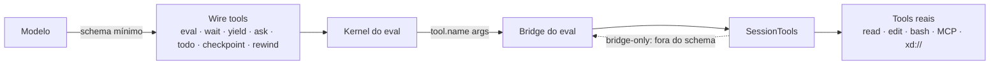

# Code Mode — Arquitetura

## Purpose

Code Mode é um perfil de apresentação de tools do omp: o modelo vê apenas um conjunto mínimo
(`eval`, `wait` e as tools com semântica de sessão/UI) e alcança todas as demais — `read`, `edit`,
`bash`, `grep`, tools de MCP, devices `xd://` — como funções `tool.<name>(args)` dentro do kernel do
`eval`. O objetivo é reduzir tokens de schema por request e manter resultados intermediários fora do
histórico, sem tirar nenhuma capacidade da sessão. Usuários são as próprias sessões do omp e os
subagentes que rodam com o perfil ligado por escopo.

**Estado deste documento:** a funcionalidade está **planejada**; não há código de produção
implementado nesta árvore. O que existe hoje é a infraestrutura de bridge do `eval`, a partição do
`xd://` e os pontos de integração citados abaixo. Tudo que é novo está marcado `[planned]`; os
testes vivem em `packages/coding-agent/test/code-mode/` como `it.todo` com corpo real.

## Stack

- Runtime / linguagens: TypeScript sobre Bun; REPLs de `eval` em JS e Python
  (`packages/coding-agent/src/eval/`).
- Frameworks: `bun:test` para a suíte; TUI própria em `packages/tui`; sem framework web no caminho.
- Storage: settings YAML (`Settings`), arquivos de sessão JSON via `SessionManager`, artifacts em
  `local://`.
- Infra / deployment: fork `kaioposnky/omp` do upstream `oh-my-pi`; distribuição como binário +
  pacotes npm. Sem serviço de rede no caminho do Code Mode.

## Structure

O sistema tem uma única decisão estrutural: a partição acontece na **camada de apresentação**, não
no registro de tools. `SessionTools` continua dono do registro; o wire do modelo recebe só o
topo. Detalhes de implementação:

- [orchestration.md](orchestration.md) — ondas de implementação, arquivos possuídos por tarefa,
  dependências, IDs de teste a virar e portões de aceite.
- [testing.md](testing.md) — mapa arquivo → IDs → o que prova, como rodar, protocolo todo→pass e
  typecheck.
- [contract.md](contract.md) — módulos planejados, formas de API, caminhos de teste e IDs fixos que
  testes, docs e implementação compartilham.

## Key decisions

- **Partição por apresentação, não por registro** — `tool.edit` continua existindo na sessão e
  alcançável pelo bridge; só o schema enviado ao modelo muda. Rejeitado: `--tools=eval,wait`, que
  estreita o registro e quebra `tool.edit(...)` com `Unknown tool from js runtime`.
- **Reusar a camada bridge-only do `xd://`, sem reusar `xdev.mountedNames`** — tools montadas do
  `xd://` também anunciam devices e exigem `read`/`write` top-level como transporte, exatamente as
  tools que o Code Mode tira do schema.
- **Módulos concentrados em `src/code-mode/`** `[planned]` — `settings.ts`, `scope.ts`,
  `partition.ts`, `catalog.ts`, `hints.ts`. Motivo: `sdk.ts` e `session/session-tools.ts` são
  arquivos quentes no upstream; a lógica pura fica isolada para reduzir conflito no
  `oh-my-pi-fork-release-sync`.
- **Default `false`** — o ganho de custo não foi medido no omp; vira default só depois do A/B de
  `packages/metaharness` com sucesso igual ou maior em pelo menos dois modelos (um Anthropic e um
  OpenAI/Codex).
- **Decisão de escopo resolvida uma vez por sessão** — trocar de modelo no meio da sessão não
  reavalia o estado; a regra é reavaliada só para o indicador e para `/code-mode status`.
- **Gates duros vencem qualquer override** — sem backend de `eval`, com frontmatter `tools` sem
  `eval`, ou com lista restrita sem `eval`, o modo fica desligado e a sessão cai no comportamento
  normal em vez de ficar sem tools úteis.

## Constraints

- Sem backend de `eval` disponível, Code Mode é inviável: a sessão não pode ficar sem tools.
- `checkpoint`, `rewind`, `yield`, `ask` e `todo` precisam continuar top-level; o bridge bloqueia
  `checkpoint`/`rewind` e os demais têm semântica de sessão ou de UI.
- `eval` é obrigatório no wire; nenhuma regra de escopo pode removê-lo.
- A partição precisa sobreviver a `setActiveToolsByName` (goal mode, extensões, MCP tardio) sem
  perder a camada bridge-only.
- O prefixo do prompt (system prompt + schemas do wire) deve permanecer byte-idêntico entre
  requests para não quebrar cache; sugestões e dicas vão no sufixo.
- O bridge não pode furar o modo de aprovação: `tool.edit` dentro do `eval` passa pelo mesmo wrapper
  ACP da chamada direta.
- Compatibilidade com o pi-jev: com Code Mode ativo, o gate de MCP não pode chamar
  `setActiveTools` e o hint de skills precisa apontar `skill://<name>`.

## Functionalities

- [macro/core.md](../macro/core.md) — partição bridge-only, alcance pelo bridge, ciclo de vida
  (MCP tardio, reconcile, fallback sem eval, aprovação).
- [macro/toggle.md](../macro/toggle.md) — default persistente, flags de CLI, `/code-mode`,
  persistência/resume/fork e campo de estado do RPC.
- [macro/indicator.md](../macro/indicator.md) — ícone na status line, divergência esmaecida,
  snapshot de startup e símbolo de tema.
- [macro/scope.md](../macro/scope.md) — resolução por agente, cargo e modelo, precedência e gates
  duros.
- [macro/integration.md](../macro/integration.md) — skills, MCP, ExtensionAPI e pi-jev sob Code
  Mode.
- [macro/token-economy.md](../macro/token-economy.md) — catálogo compacto, dicas no sufixo, teto de
  saída do eval e prefixo congelado.
- [macro/spawn.md](../macro/spawn.md) — `codeMode` no spawn de subagentes e `agent(fork)`.
- [macro/rlm.md](../macro/rlm.md) — input grande como handle e tool `elide`.
- [macro/needle.md](../macro/needle.md) — spike de medição da Needle 3 para tool calling.
