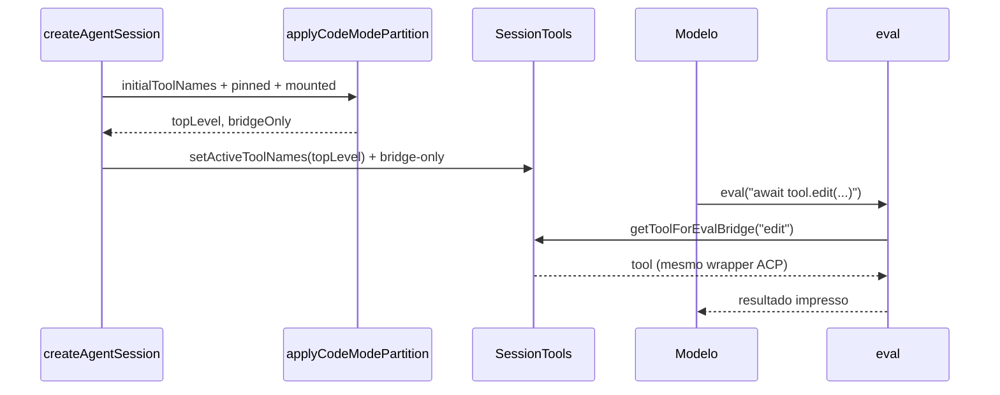

# Core (partição bridge-only) — Macro

Parent: [architecture/index.md](../architecture/index.md)

## Purpose

Expor ao modelo apenas o conjunto mínimo de tools e transformar todo o resto em funções
`tool.<name>(args)` dentro do `eval`. O usuário ganha uma sessão com o mesmo poder de antes — `read`,
`edit`, `bash`, `grep`, MCP — pagando menos schema por request; o histórico recebe só o que o modelo
imprimir, porque resultados intermediários ficam em variáveis do kernel. O escopo desta
funcionalidade é a partição em si e o ciclo de vida da camada bridge-only: criação da sessão, MCP
descoberto depois, reconcile por `setActiveToolsByName`, fallback sem backend de `eval` e passagem
pelo modo de aprovação.

## Inputs / Outputs

| | What | From / To |
| --- | --- | --- |
| Input | Lista inicial de tools da sessão, tools fixadas pelo usuário, mounts do `xd://`, tools MCP descobertas em runtime | `createAgentSession` (`packages/coding-agent/src/sdk.ts#createAgentSession`) |
| Input | Decisão `enabled`/`source` do escopo e do toggle | [macro/scope.md](scope.md), [macro/toggle.md](toggle.md) |
| Input | Disponibilidade do backend de `eval` | `packages/coding-agent/src/tools/eval-backends.ts` |
| Output | Wire do modelo com só `eval`, `wait`, `yield`, `ask`, `todo`, `checkpoint`, `rewind` (+ tools fixadas explicitamente) | `session.agent.state.tools` |
| Output | Camada bridge-only consultável | `session.getToolForEvalBridge(name)`, `session.getBridgeOnlyToolNames()` `[planned]` |
| Output | Sessão normal quando o modo não pode ser aplicado | `session.isCodeModeActive() === false` `[planned]` |

## Entry points

- `createAgentSession({ codeMode: ... })` `[planned]` → partição em `sdk.ts` antes de
  `setSessionActiveToolNames`.
- `SessionTools#getToolForEvalBridge(name)` (`packages/coding-agent/src/session/session-tools.ts#getToolForEvalBridge`)
  → resolução do `tool.<name>` no kernel; é o único caminho de execução das tools fora do schema.
- `SessionTools#setActiveToolsByName` e `SessionTools#refreshMCPTools` → reconcile que precisa
  preservar a camada bridge-only.
- `/code-mode status` e o status line (via [macro/toggle.md](toggle.md) e
  [macro/indicator.md](indicator.md)) → consomem a decisão e o número de tools em bridge-only.

## Flow

## Dependencies

- Outra funcionalidade: [macro/toggle.md](toggle.md) — decide se a partição é aplicada.
- Outra funcionalidade: [macro/scope.md](scope.md) — decide por agente, cargo e modelo.
- Outra funcionalidade: [macro/integration.md](integration.md) — skills, MCP e ExtensionAPI
  dependem da camada bridge-only existir.
- Infra existente: REPL e bridge do `eval` (`packages/coding-agent/src/eval/js/tool-bridge.ts`),
  partição do `xd://` (`packages/coding-agent/src/tools/xdev.ts#XDEV_KEEP_TOP_LEVEL`).
- Sem serviço externo.

## Requirements

- [micro/core-partition.md](../micro/core-partition.md) — o que aparece no wire e o que continua
  alcançável pelo bridge.
- [micro/core-bridge-lifecycle.md](../micro/core-bridge-lifecycle.md) — MCP tardio, reconcile,
  fallback sem `eval` e aprovação.
