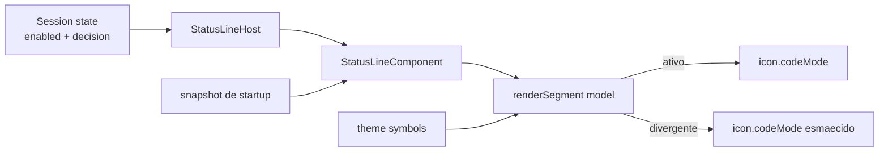

# Indicador na tela — Macro

Parent: [architecture/index.md](../architecture/index.md)

## Purpose

Tornar o modo visível sem ocupar contexto: um símbolo `icon.codeMode` no segmento de modelo da
status line quando a sessão está em Code Mode, uma variante esmaecida quando a regra de escopo atual
divergiu do estado congelado (por exemplo, troca de modelo no meio da sessão), e o campo `codeMode`
no snapshot de startup para que a primeira renderização já saia correta. O usuário precisa saber em
qual modo está antes de escrever o próximo prompt — inclusive quando a resposta é "a regra diz uma
coisa e a sessão está em outra".

## Inputs / Outputs

| | What | From / To |
| --- | --- | --- |
| Input | `session.isCodeModeActive()` — estado congelado | [macro/toggle.md](toggle.md) |
| Input | `session.getCodeModeDecision()` — `source` e `detail` da regra atual | [macro/scope.md](scope.md) |
| Input | Snapshot de startup (`codeMode: boolean`) | processo que cria a TUI |
| Input | Símbolo do tema | `packages/tui/src/theme/symbols.ts#icon.codeMode` |
| Output | Ícone ativo/esmaecido no segmento de modelo (`renderSegment` existente) | `packages/tui/src/status-line/segments.ts#renderSegment` |
| Output | Campo `codeMode` aceito e devolvido pelo validador de startup | `packages/tui/src/status-line/startup.ts#readStatusLineStartupData` |

## Entry points

- `statusLine` → segmento `model`, renderizado por `renderSegment`; consulta o host.
- Host da status line (`packages/tui/src/status-line/host.ts#StatusLineHost`) → precisa expor o
  estado de Code Mode no mesmo nível de `isFastModeActive`.
- `Component#updateFrom` / comparação de estado da status line → invalidação quando o estado muda.
- `readStatusLineStartupData(value)` → valida o snapshot inicial.
- `/code-mode status` → mostra a mesma decisão em texto (origem e contagem bridge-only), sem
  duplicar a lógica de renderização.

## Flow

## Dependencies

- Outra funcionalidade: [macro/toggle.md](toggle.md) — expõe o estado e a decisão na sessão.
- Outra funcionalidade: [macro/scope.md](scope.md) — a divergência só existe porque a regra pode
  mudar sem alterar o estado.
- Infra existente: status line (`packages/tui/src/status-line/component.ts`), tema
  (`packages/tui/src/theme/symbols.ts`), snapshot de startup
  (`packages/tui/src/status-line/startup.ts`).

## Requirements

- [micro/indicator-status-icon.md](../micro/indicator-status-icon.md) — ícone, tema e snapshot de
  startup.
- [micro/indicator-divergence.md](../micro/indicator-divergence.md) — variante esmaecida quando a
  regra diverge do estado.
