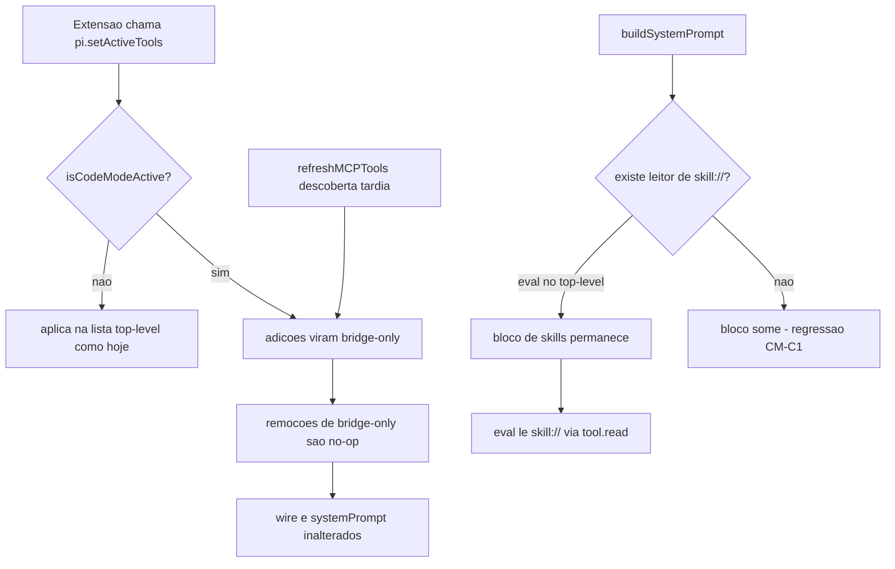

# Integração (skills, MCP, extensões e pi-jev) — Macro

Parent: [architecture/index.md](../architecture/index.md)

## Purpose

Manter funcionando, com o Code Mode ligado, tudo aquilo que hoje depende de uma tool top-level para aparecer no prompt ou para ser ativada: o catálogo de skills, as tools MCP, o `setActiveTools` das extensões e o roteamento do pi-jev. No Code Mode só `eval`, `wait`, `yield`, `ask`, `todo`, `checkpoint` e `rewind` ficam no wire; as demais tools passam a ser alcançáveis apenas como `tool.<nome>(...)` dentro do kernel. Esta funcionalidade garante que essa troca de camada não apague capacidades nem quebre o cache de prompt.

## Inputs / Outputs

| | O quê | De / Para |
|---|---|---|
| Input | Índice de skills (`nome: descrição`) e corpo via `skill://` | `packages/coding-agent/src/system-prompt.ts#buildSystemPrompt` |
| Input | Registro/remoção de tools MCP em runtime | `packages/coding-agent/src/session/session-tools.ts#refreshMCPTools` |
| Input | `pi.setActiveTools([...])` de extensões | `packages/coding-agent/src/extensibility/extensions/types.ts#ExtensionAPI` |
| Input | Roteamento por prompt do pi-jev (`McpGate`, `AutoJev`, `jev_find_tools`) | `vendor/pi-jev/src/mcp-gate.ts#McpGate`, `vendor/pi-jev/src/auto.ts#AutoJev`, `vendor/pi-jev/src/tools.ts#registerJevTools` |
| Output | Bloco de skills no system prompt, com instrução de leitura via `eval` | `packages/coding-agent/src/system-prompt.ts#toolReadsSkillUris` |
| Output | Catálogo bridge-only (`tool.<nome>` + resumo) no prompt | `[planned] packages/coding-agent/src/code-mode/catalog.ts#renderBridgeCatalog` |
| Output | Camada bridge-only mutável, fora do wire | `[planned] packages/coding-agent/src/session/session-tools.ts` (conjunto paralelo a `xd://` mounts) |
| Output | `pi.isCodeModeActive()` para extensões | `[planned] packages/coding-agent/src/extensibility/extensions/types.ts#ExtensionAPI.isCodeModeActive` |

## Entry points

- `packages/coding-agent/src/system-prompt.ts#buildSystemPrompt` → decide se há leitor de `skill://` (`toolReadsSkillUris`) e, portanto, se o bloco de skills entra no prompt.
- `packages/coding-agent/src/extensibility/extensions/runner.ts#ExtensionRunner.initialize` → instala o `runtime.setActiveTools` que as extensões chamam; é o ponto único onde a política do Code Mode pode interceptar.
- `packages/coding-agent/src/session/session-tools.ts#setActiveToolsByName` → reconcilia a lista ativa quando a sessão/CLI troca tools.
- `packages/coding-agent/src/session/session-tools.ts#refreshMCPTools` → absorve descoberta tardia de MCP.
- `vendor/pi-jev/src/mcp-gate.ts#McpGate.route` e `vendor/pi-jev/src/auto.ts#AutoJev.route` → chamam `pi.setActiveTools` a cada prompt no comportamento atual.
- `vendor/pi-jev/src/tools.ts#registerJevTools` → define `jev_find_tools`, que hoje ativa tools em vez de sugeri-las.

## Flow

## Dependencies

- Núcleo da partição: [macro/core.md](core.md) — a camada bridge-only nasce lá.
- Catálogo e cache: [macro/token-economy.md](token-economy.md) — o catálogo bridge-only é também o mecanismo de prompt mínimo.
- Subagentes: [macro/spawn.md](spawn.md) — filhos herdam a decisão, não o estado mutável do pai.
- Serviço externo: extensão pi-jev, versionada em `vendor/pi-jev/` dentro do fork (o repo de origem fica em `~/.omp/agent/extensions/pi-jev` segundo `docs/code-mode-requirements.md`, F6).
- Dependência de contrato: RF6.4 (`pi.isCodeModeActive()`) é pré-requisito dos ajustes de RF6.5.

## Requirements

- [micro/integration-skills-catalog.md](../micro/integration-skills-catalog.md)
- [micro/integration-mcp-catalog.md](../micro/integration-mcp-catalog.md)
- [micro/integration-extension-active-tools.md](../micro/integration-extension-active-tools.md)
- [micro/integration-pi-jev.md](../micro/integration-pi-jev.md)
