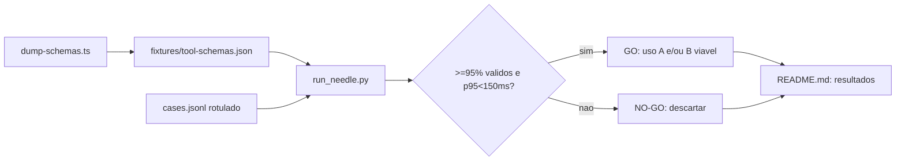

# Needle 3 (spike de avaliação) — Macro

Parent: [architecture/index.md](../architecture/index.md)

## Purpose

Decidir, com medição, se a Needle 3 (Cactus Compute) tem lugar no Code Mode — ou se o `tool.describe`/`tool.search` do kernel e o Jev já cobrem o problema. O Code Mode **reduz** a necessidade de JSON de tool call: o modelo principal escreve código e o bridge valida os argumentos de cada `tool.*`. A Needle só se paga em dois usos candidatos: (A) selecionar top-k tools do catálogo bridge-only e (B) reparar JSON de tool call inválido de modelos `smol`/`tiny`/locais. O spike roda fora do fork, em `needle-spike/`, e não integra nada ao produto.

## Contexto do modelo (fontes)

- Modelo on-device de tool calling, extração estruturada e embeddings; Apache-2.0. [HF model card](https://huggingface.co/Cactus-Compute/needle3)
- 25–121M parâmetros, 8–29 MB em CQ2 2-bit, de 2 a 20 camadas a partir de um único peso; lançado em 2026-09-17. [cactuscompute.com/needle](https://cactuscompute.com/needle)
- Runtime via pacote Python `cactus-compute`/`cactus-needle` ou WebAssembly.

Os números acima vêm de `docs/code-mode-requirements.md` (F5), que cita as duas páginas; não foram re-medidos neste repo — tratá-los como declaração do fornecedor.

## Inputs / Outputs

Todos os caminhos `needle-spike/...` citados neste documento e nos filhos são relativos a `harnesses-improver/` (um nível acima deste fork, `oh-my-pi/`).

| | O quê | De / Para |
|---|---|---|
| Input | Wire schema real de cada tool do omp | `packages/ai/src/utils/schema/wire.ts#toolWireSchema` |
| Input | Conjunto rotulado de prompts → args esperados | `needle-spike/cases.jsonl` |
| Input | Prompts do seletor (uso A) e chamadas malformadas (uso B) | `needle-spike/cases.jsonl` |
| Output | Fixture congelada dos schemas | `needle-spike/fixtures/tool-schemas.json` |
| Output | % de args válidos por tool e p50/p95 de latência em CPU | `needle-spike/run_needle.py` |
| Output | Veredito GO/NO-GO e tabela de resultados | `needle-spike/README.md` |

## Critério go/no-go (RF5.2)

- ≥ 95% de args válidos nas tools-alvo **e** p95 < 150 ms. Abaixo disso, descartar.
- Se entrar no fork no futuro: integração opcional, desligada por padrão, sem dependência Python obrigatória (RF5.3).
- Nunca no caminho crítico de tools com efeito (`edit`, `bash`, `write`) sem confirmação — reparo errado vira mutação errada (RF5.4).

**Resultado medido: NO-GO.** Seletor 10–20%, reparo 20% (3/30 e 6/30 sobre as descrições reais), p50 94–118 ms, p95 172–251 ms — abaixo dos 95% de acertos e acima do teto de 150 ms. Máquina, comandos e tabela completa em `needle-spike/README.md` (seção "Resultados").

## Entry points

- `needle-spike/dump-schemas.ts` → NDL-1: cria uma sessão real com `createAgentSession` e grava `toolWireSchema` de cada tool em `fixtures/tool-schemas.json`.
- `needle-spike/run_needle.py` → NDL-2/NDL-3: roda acurácia, latência e gate GO/NO-GO sobre `cases.jsonl`.
- `needle-spike/README.md` → relatório: como rodar, tabela de resultados, veredito.

## Flow

## Dependencies

- Núcleo: [macro/core.md](core.md) — o uso A pressupõe catálogo bridge-only (`tool.describe`/`tool.search`).
- Integração: [macro/integration.md](integration.md) — RF6.7 aponta o seletor de tools como ponto natural para a Needle ou para o próprio Jev.
- Economia de tokens: [macro/token-economy.md](token-economy.md) — o valor de (A) é evitar round-trips de `tool.describe`; o de (B) é resgatar chamadas de modelos pequenos.
- Externo: runtime Python `cactus-needle`/`cactus-compute` e os pesos publicados em `Cactus-Compute/needle3`.

## Requirements

- [micro/needle-schema-fixture.md](../micro/needle-schema-fixture.md)
- [micro/needle-arg-validity.md](../micro/needle-arg-validity.md)
- [micro/needle-latency-gonogo.md](../micro/needle-latency-gonogo.md)
