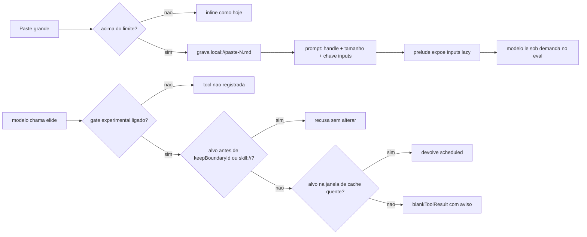

# RLM e contexto como dado — Macro

Parent: [architecture/index.md](../architecture/index.md)

## Purpose

Transformar contexto grande em dado manipulável pelo modelo, em vez de texto colado no prompt. Duas frentes: (1) quando um paste ou anexo passa de um limite de tokens, ele deixa de ser inline e vira um handle `local://paste-N.md` que o kernel expõe como `inputs["paste-N"]` (mapa lazy, lido sob demanda); (2) uma tool `elide` permite ao modelo apagar resultados de tool já consumidos, substituindo-os por um aviso curto, sem perder a possibilidade de recuperação via `history://`/artifacts. Ambas só fazem sentido com `eval` disponível e ficam atrás de settings próprios.

## Inputs / Outputs

| | O quê | De / Para |
|---|---|---|
| Input | Paste/arquivo anexado acima do limite `input.largeInputAsHandle` | `packages/coding-agent/src/modes/controllers/input-controller.ts#attachPasteAsFile` |
| Input | `elide({ toolCallIds, reason? })` do modelo | `packages/coding-agent/src/tools/context-notes.ts` (tool nova) |
| Input | Config de cache/lookback do próximo request | `packages/agent/src/compaction/pruning.ts#PruneConfig` |
| Output | Prompt com `local://paste-3.md (≈1.8M tokens, 41k linhas). Disponível no eval como inputs["paste-3"].` | `packages/coding-agent/src/modes/controllers/input-controller.ts` |
| Output | `inputs` no prelude JS/Python | `packages/coding-agent/src/eval/js/shared/prelude.ts` |
| Output | Tool results blankados com `[Elided by model - N tokens]` | `packages/agent/src/compaction/pruning.ts` (reuso de `blankToolResult`) |
| Output | Estado adiado quando o alvo está na janela de cache quente | `packages/agent/src/compaction/pruning.ts#PruneConfig.cacheWarmSuffixTokens` |

## Entry points

- `packages/coding-agent/src/modes/controllers/input-controller.ts#attachPasteAsFile` → já grava `local://paste-N.md` e insere a referência no editor, mas só depois de um menu interativo.
- `packages/coding-agent/src/eval/js/shared/prelude.txt#read` → `read(path)` delega qualquer URI com esquema (`shouldDelegateRead`) para a tool `read`, o que faz `read("skill://…")` e `read("local://…")` funcionarem no kernel.
- `packages/agent/src/compaction/pruning.ts#PruneConfig` → definição de `keepBoundaryId`, `protectTokens`, `cacheWarmSuffixTokens` e `protectedTools` — o mesmo vocabulário que o `elide` deve respeitar.
- `packages/coding-agent/src/session/context-settings.ts#cfgCompactionExperimentalContextManagement` → gate de `compaction.experimentalContextManagement`, idêntico ao de `context_notes`/`new_context` (`packages/coding-agent/src/tools/context-notes.ts#ContextNotesTool`).

## Flow

## Dependencies

- Núcleo: [macro/core.md](core.md) — sem avaliação de eval disponível, o handle não tem onde ser lido.
- Economia de tokens: [macro/token-economy.md](token-economy.md) — o handle evita $H$; o elide reduz $H$ sem reescrever o prefixo quente.
- Integração: [macro/integration.md](integration.md) — `read`/`skill://` via bridge é pré-requisito do handle `local://`.
- Mecanismos existentes: pruning automático em `packages/agent/src/compaction/pruning.ts#pruneToolOutputs` e recuperação por `history://` (`packages/coding-agent/src/internal-urls/history-protocol.ts`).

## Requirements

- [micro/rlm-large-input-handle.md](../micro/rlm-large-input-handle.md)
- [micro/rlm-elide.md](../micro/rlm-elide.md)
