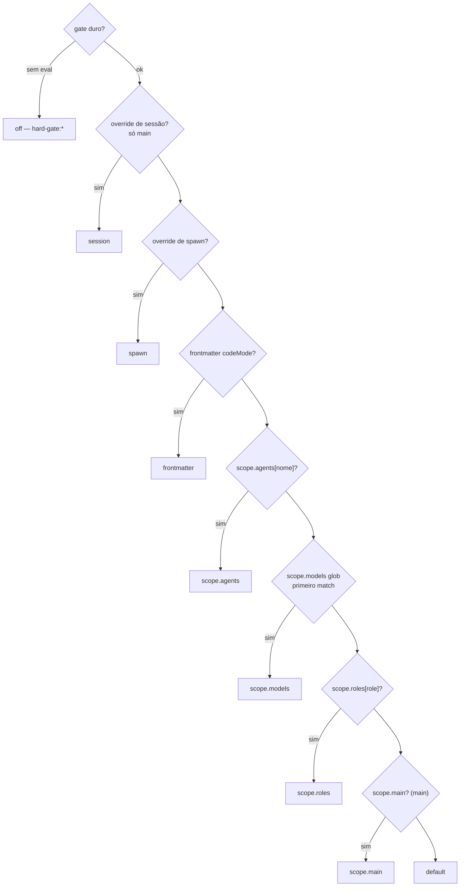

# Escopo por agente, cargo e modelo — Macro

Parent: [architecture/index.md](../architecture/index.md)

## Purpose

Decidir, para cada sessão filha, se o Code Mode vale — sem herdar cegamente o estado do pai. A regra
combina defaults de fábrica (subagentes baratos ficam no modo normal), `scope.agents`,
`scope.models` (glob sobre `provider/id`), `scope.roles`, `scope.main` e o pedido explícito do
modelo no spawn, sempre subordinada a gates duros: sem backend de `eval`, frontmatter com lista de
tools sem `eval`, ou lista restrita sem `eval`, o resultado é desligado com motivo. Cada decisão
carrega `source` e `detail`, que alimentam `/code-mode status` e o indicador.

## Inputs / Outputs

| | What | From / To |
| --- | --- | --- |
| Input | `codeMode.scope` (`main`, `agents`, `roles`, `models`) e `codeMode.default` | settings ([macro/toggle.md](toggle.md)) |
| Input | Frontmatter `codeMode` e `tools` do agente | descoberta de agentes (`packages/coding-agent/src/task/discovery.ts` / `types.ts`) `[planned]` |
| Input | `codeMode` no spawn (`task` item, `agent()`, `workpool()`) | [macro/spawn.md](spawn.md) |
| Input | Role e `provider/id` do modelo já resolvido | resolução de modelo da sessão |
| Input | `evalAvailable`, `restrictedToolNames`, `planMode` | sessão |
| Output | `CodeModeDecision` (`enabled`, `source`, `detail`, `denied`) | `resolveCodeMode` `[planned]` |
| Output | Estado da sessão filha passado ao `createAgentSession` | [macro/core.md](core.md) |

## Entry points

- `resolveCodeMode(input)` em `packages/coding-agent/src/code-mode/scope.ts` `[planned]` — função
  pura; é a única fonte de precedência.
- `params.scope` / `params.codeMode` no spawn do subagente
  (`packages/coding-agent/src/task/structured-subagent.ts#runStructuredSubagent`) — ponto planejado
  `[planned]` que resolve depois do modelo.
- `/code-mode status` — imprime a decisão efetiva e sua origem.
- Settings `codeMode.scope` — validação na leitura (`validate`).

## Flow

## Dependencies

- Outra funcionalidade: [macro/core.md](core.md) — aplica o resultado da decisão.
- Outra funcionalidade: [macro/toggle.md](toggle.md) — fornece default e overrides de sessão.
- Outra funcionalidade: [macro/spawn.md](spawn.md) — caminho do override explícito.
- Outra funcionalidade: [macro/indicator.md](indicator.md) — consome `source`/`detail` para a
  divergência.
- Infra existente: resolução de modelo/role (`packages/coding-agent/src/config/model-resolver.ts`),
  settings (`packages/coding-agent/src/config/registry.ts#register`).

## Requirements

- [micro/scope-precedence.md](../micro/scope-precedence.md) — escada de precedência, não-herança e
  motivo da decisão.
- [micro/scope-hard-gates.md](../micro/scope-hard-gates.md) — gates duros e `denied.reason`.
- [micro/scope-model-globs.md](../micro/scope-model-globs.md) — glob de modelo e fallback por role.
- [micro/scope-defaults-validation.md](../micro/scope-defaults-validation.md) — defaults de fábrica
  e validação dos settings.
