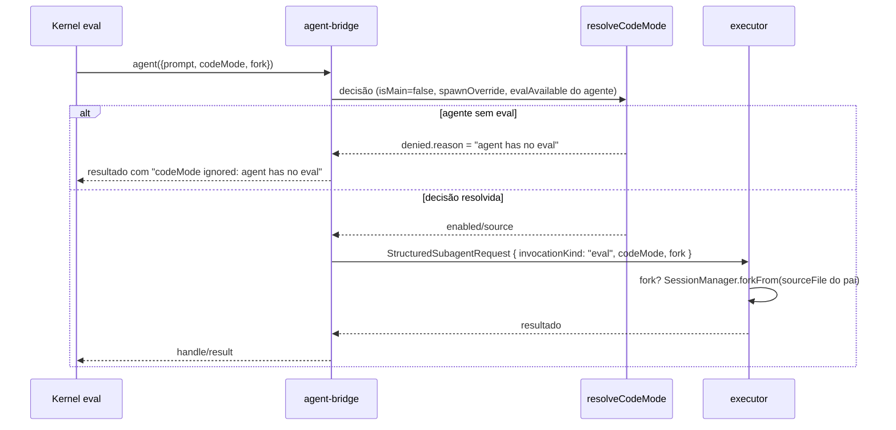

# Subagentes (spawn e fork) — Macro

Parent: [architecture/index.md](../architecture/index.md)

## Purpose

Levar a decisão do Code Mode para dentro da árvore de subagentes e permitir o padrão "fork N vezes, explorar abordagens, devolver as melhores". Hoje `agent()`, `workpool()` e itens de task não têm como pedir Code Mode, e o fork só existe pelo agente `seance` com `invocationKind: "task"`. Esta funcionalidade expõe `codeMode?: boolean` nesses três pontos e `fork?: boolean` em `agent()`, resolvendo a decisão pelo mesmo `resolveCodeMode` do processo principal — com hard gate de eval — e recusando fork sem sessão pai persistida.

## Inputs / Outputs

| | O quê | De / Para |
|---|---|---|
| Input | `agent({ prompt, agent?, codeMode?, fork?, ... })` do kernel | `packages/coding-agent/src/eval/agent-bridge.ts#runEvalAgent` |
| Input | Item de task / `workpool()` com `codeMode?` | `packages/coding-agent/src/task/structured-subagent.ts#StructuredSubagentRequest` |
| Input | Sessão pai persistida (para `fork: true`) | `packages/coding-agent/src/session/session-manager.ts#SessionManager.forkFrom` |
| Output | Filho com partição bridge-only coerente com a decisão | `[planned] packages/coding-agent/src/code-mode/scope.ts#resolveCodeMode` |
| Output | Recusa explícita `codeMode ignored: agent has no eval` quando o agente não tem eval | `[planned] packages/coding-agent/src/eval/agent-bridge.ts` (mensagem no resultado do bridge) |
| Output | Filho forkado contendo as mensagens do pai | `packages/coding-agent/src/task/executor.ts` (ramo `preparedSession.fork`) |

## Entry points

- `packages/coding-agent/src/eval/agent-bridge.ts#agentArgsSchema` → schema `@oh-my-pi/omptype` (importado como `type`) que aceita os argumentos de `agent()`; hoje não conhece `codeMode` nem `fork` e descarta chaves não declaradas (`"+": "delete"`).
- `packages/coding-agent/src/eval/agent-bridge.ts#runEvalAgent` → valida, registra o job e devolve handle.
- `packages/coding-agent/src/task/structured-subagent.ts#StructuredSubagentRequest` → contrato interno compartilhado por task e eval (`invocationKind: "task" | "eval"`, `sourceSession?`).
- `packages/coding-agent/src/task/seance.ts#prepareSeance` → único caminho que hoje monta `PreparedSeanceSession` e seu `fork.sourceFile`.
- `packages/coding-agent/src/task/executor.ts` → consome `preparedSession.fork` e chama `SessionManager.forkFrom`; já falha com "requires a persisted child session file" quando falta o arquivo.
- `packages/coding-agent/src/session/session-manager.ts#SessionManager.forkFrom` → copia header/histórico do pai, podando a cauda se pedido.

## Flow

## Dependencies

- Núcleo: [macro/core.md](core.md) — o filho usa a mesma partição bridge-only.
- Escopo: a decisão do filho vem de `resolveCodeMode`; a precedência (`session` > `spawn` > `frontmatter` > `scope.*` > `default`) está fixada no contrato compartilhado (`CodeModeResolveInput`/`CodeModeDecision`) e coberta por `CM-S1` em `packages/coding-agent/test/code-mode/scope.test.ts`.
- Economia de tokens: [macro/token-economy.md](token-economy.md) — fork re-lê o histórico inteiro, com cache frio no primeiro request; precisa ser caro por desenho e explícito no prompt.
- Integração: [macro/integration.md](integration.md) — o filho herda skills/MCP pela mesma camada.
- Restrição existente: `prepareSeance` recusa `invocationKind !== "task"` e isolation/custom tools (`docs/code-mode-plan.md` §5).

## Requirements

- [micro/spawn-agent-code-mode-param.md](../micro/spawn-agent-code-mode-param.md)
- [micro/spawn-code-mode-denial.md](../micro/spawn-code-mode-denial.md)
- [micro/spawn-agent-fork.md](../micro/spawn-agent-fork.md)
