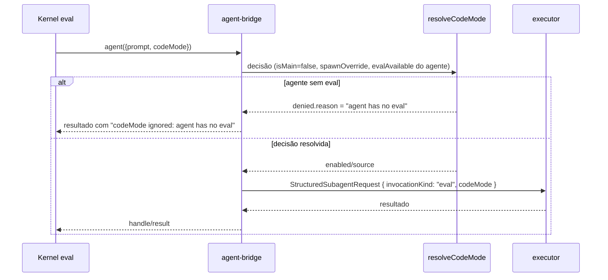

# Subagentes (spawn) — Macro

Parent: [architecture/index.md](../architecture/index.md)

## Purpose

Levar a decisão do Code Mode para dentro da árvore de subagentes. Hoje `agent()`, `workpool()` e itens de task não têm como pedir Code Mode. Esta funcionalidade expõe `codeMode?: boolean` nesses três pontos, resolvendo a decisão pelo mesmo `resolveCodeMode` do processo principal — com hard gate de eval. O `agent({ fork })` foi removido porque o upstream apagou a infraestrutura de fork do `seance` que ele reaproveitava.

## Inputs / Outputs

| | O quê | De / Para |
|---|---|---|
| Input | `agent({ prompt, agent?, codeMode?, ... })` do kernel | `packages/coding-agent/src/eval/agent-bridge.ts#runEvalAgent` |
| Input | Item de task / `workpool()` com `codeMode?` | `packages/coding-agent/src/task/structured-subagent.ts#StructuredSubagentRequest` |
| Output | Filho com partição bridge-only coerente com a decisão | `packages/coding-agent/src/code-mode/scope.ts#resolveCodeMode` |
| Output | Recusa explícita `codeMode ignored: agent has no eval` quando o agente não tem eval | `packages/coding-agent/src/eval/agent-bridge.ts` (mensagem no resultado do bridge) |

## Entry points

- `packages/coding-agent/src/eval/agent-bridge.ts#agentArgsSchema` → schema `@oh-my-pi/omptype` (importado como `type`) que aceita os argumentos de `agent()`; hoje não conhece `codeMode` e descarta chaves não declaradas (`"+": "delete"`).
- `packages/coding-agent/src/eval/agent-bridge.ts#runEvalAgent` → valida, registra o job e devolve handle.
- `packages/coding-agent/src/task/structured-subagent.ts#StructuredSubagentRequest` → contrato interno compartilhado por task e eval (`invocationKind: "task" | "eval"`, `sourceSession?`).

## Flow

## Dependencies

- Núcleo: [macro/core.md](core.md) — o filho usa a mesma partição bridge-only.
- Escopo: a decisão do filho vem de `resolveCodeMode`; a precedência (`session` > `spawn` > `frontmatter` > `scope.*` > `default`) está fixada no contrato compartilhado (`CodeModeResolveInput`/`CodeModeDecision`) e coberta por `CM-S1` em `packages/coding-agent/test/code-mode/scope.test.ts`.
- Integração: [macro/integration.md](integration.md) — o filho herda skills/MCP pela mesma camada.

## Requirements

- [micro/spawn-agent-code-mode-param.md](../micro/spawn-agent-code-mode-param.md)
- [micro/spawn-code-mode-denial.md](../micro/spawn-code-mode-denial.md)
