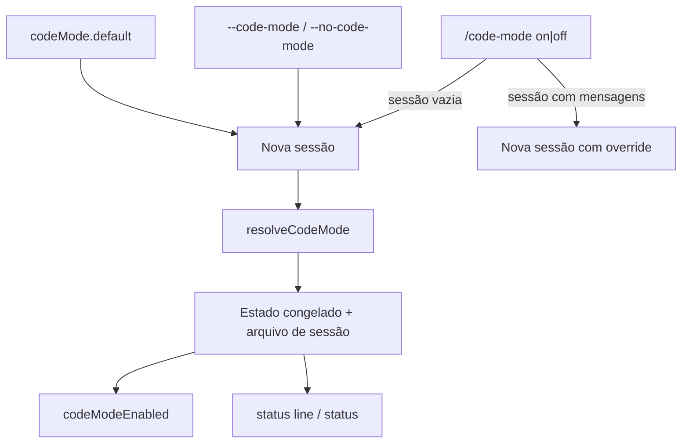

# Toggle (ativar, desativar e default) — Macro

Parent: [architecture/index.md](../architecture/index.md)

## Purpose

Dar ao usuário uma forma previsível de ligar e desligar o Code Mode sem reiniciar o processo por
acidente: um default persistente (`codeMode.default`), flags de CLI para um processo, um comando
`/code-mode` com `on/off/status/default`, estado congelado na criação da sessão (persistido, herdado
no fork) e um campo no RPC para clientes observarem o estado. A regra central é que mudar de modo
não pode alterar silenciosamente o wire de uma conversa em andamento.

## Inputs / Outputs

| | What | From / To |
| --- | --- | --- |
| Input | `codeMode.default` (boolean, default `false`) | settings (`Settings.isolated`, arquivo do usuário) |
| Input | `--code-mode` / `--no-code-mode` | `parseArgs` (`packages/coding-agent/src/cli/args.ts#parseArgs`) → `Args.codeMode` `[planned]` |
| Input | `/code-mode on\|off\|status\|default on\|default off` (spec `[planned]`) | `BUILTIN_MODE_SLASH_COMMANDS` (`packages/coding-agent/src/slash-commands/builtin-modes.ts#BUILTIN_MODE_SLASH_COMMANDS`) |
| Input | Estado gravado no arquivo de sessão | `SessionManager` (resume, fork) |
| Output | `session.isCodeModeActive()` / `getCodeModeDecision()` | status line, `/code-mode status`, subagentes `[planned]` |
| Output | Sessão nova no estado pedido | `/code-mode on` ou `off` numa sessão com mensagens |
| Output | `codeModeEnabled` no snapshot de estado | RPC (`packages/coding-agent/src/modes/rpc/wire/state.ts#stateDefs`) `[planned]` |

## Entry points

- `parseArgs(["--code-mode"])` → `Args.codeMode === true`; ausência → `undefined`.
- `/code-mode` (builtin) → handler no padrão do `/fast`, com `handle`, `handleTui`,
  `getTuiAutocompleteDescription` e `refreshStatusLine`.
- `createAgentSession` sem opção explícita → resolve `codeMode.default` e congela o estado.
- `SessionManager.forkFrom` (`packages/coding-agent/src/session/session-manager.ts#SessionManager.forkFrom`)
  → copia o estado gravado da origem.
- RPC `session state` → campo `codeModeEnabled`.

## Flow

## Dependencies

- Outra funcionalidade: [macro/core.md](core.md) — é o comportamento que o toggle liga.
- Outra funcionalidade: [macro/scope.md](scope.md) — fornece a decisão e a origem mostrada em
  `status`.
- Outra funcionalidade: [macro/indicator.md](indicator.md) — consumidor do estado na TUI.
- Infra existente: `Settings` (`packages/coding-agent/src/config/settings.ts#Settings`),
  `SessionManager`, registro de slash commands, RPC.

## Requirements

- [micro/toggle-default-setting.md](../micro/toggle-default-setting.md) — default persistente.
- [micro/toggle-cli-flags.md](../micro/toggle-cli-flags.md) — flags de processo.
- [micro/toggle-persistence.md](../micro/toggle-persistence.md) — gravação, resume e fork.
- [micro/toggle-slash-command.md](../micro/toggle-slash-command.md) — `/code-mode` e semântica de
  sessão vazia versus cheia.
- [micro/toggle-rpc-state.md](../micro/toggle-rpc-state.md) — exposição no RPC.
